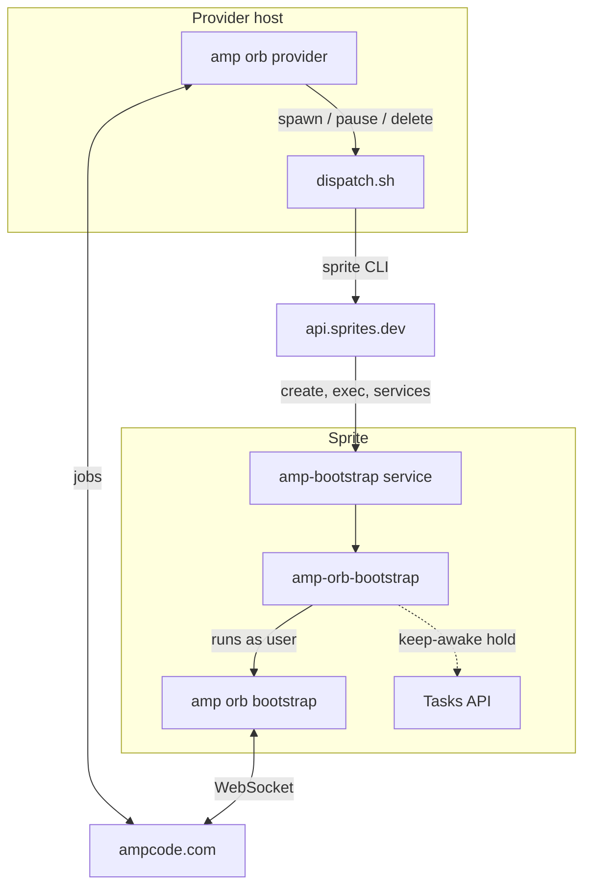

# Fly.io Sprites Orb Provider for Amp Code

Run [Amp](https://ampcode.com) orbs on your own [Fly.io Sprites](https://sprites.dev). Each Amp thread gets a dedicated, persistent Linux VM in your Sprites organization. You control the compute, the network, and the bill.

**Features**

- **One sprite per thread.** Each sprite is created on the first message and destroyed when the thread is deleted.
- **Persistent workspace.** Files, dependencies, and databases survive pause and resume.
- **Pay for active time only.** Sprites suspend when a thread goes idle and wake on the next message.
- **Batteries included.** Node, npm, Go, Bun, git, gh, tmux, and ripgrep are ready on every orb.
- **No inbound access.** The provider and orbs connect out to Amp. No ports, ingress, or DNS are needed.

**Contents**

- [Getting started](#getting-started)
- [Preparing your repository](#preparing-your-repository)
- [Running in production](#running-in-production)
- [Lifecycle and billing](#lifecycle-and-billing)
- [Configuration reference](#configuration-reference)
- [Troubleshooting](#troubleshooting)
- [Limitations](#limitations)
- [Architecture](#architecture)
- [Development](#development)

## Getting started

### Prerequisites

- An Amp workspace with self-hosted orbs enabled. A workspace admin can turn this on in the Orbs settings.
- A Fly.io Sprites organization and API token. Create the token at [sprites.dev/account](https://sprites.dev/account).
- A host to run the provider: macOS or Linux with `amp`, `jq`, `curl`, and the `sprite` CLI.

```sh
curl https://sprites.dev/install.sh | bash
```

### 1. Connect the sprite CLI

```sh
sprite auth setup --token "<org-slug>/<org-id>/<token-id>/<token-value>"
```

### 2. Register the provider in Amp

In your Amp workspace settings, open **Custom Orb Providers** and create a provider. Copy the `aop_live_…` token. Amp shows it only once.

### 3. Start the provider

```sh
export AMP_ORB_PROVIDER_TOKEN=aop_live_...
amp orb provider "$PWD/dispatch.sh"
```

The provider holds an outbound connection to Amp and waits for jobs.

### 4. Create your first orb

In Amp, start a new thread, expand **Orb**, and select your provider under **Self-Hosted**. The first spawn takes about 20 seconds, plus your repository's setup time. Follow progress in the thread's setup log.

### 5. Verify (optional)

```sh
./smoke-test.sh
```

This runs a full spawn, pause, resume, and delete cycle against a throwaway sprite, then removes it.

## Preparing your repository

Amp runs your repository's `.agents/setup` script on each new orb. To get a working environment on the first message:

**Make setup complete.** The script should leave the app ready to run, not just install dependencies. For example, after installing packages, it should also create the database, run migrations, and generate any required config or keys.

**Make setup idempotent.** It may run more than once on the same disk. Check before installing system packages, and use non-interactive flags.

**Listen on `$PORT`.** Amp assigns each dev server a port and routes its portal there. A server bound to a fixed port causes the portal to report *"nothing is listening on port N."* Have your dev command read the port from `$PORT`, falling back to your usual default when it's unset, so local development is unaffected. For example, with Vite:

```sh
vite --port ${PORT:-5173} --strictPort
```

`--strictPort` makes Vite fail instead of silently picking another port. Alternatively, pin the port with `amp orb service start --port <n>` or `port:` in `.amp/services.yaml`.

**Install extra runtimes with apt.** Node, npm, Go, Bun, Deno, Python, Ruby, Rust, Java, and Elixir are preinstalled. Install anything else, such as PHP, with `sudo apt-get install` in `.agents/setup`. The orb user has passwordless sudo.

**Approve npm install scripts if needed.** npm 12 blocks dependency install scripts by default. Allow the ones you need with `npm install-scripts approve <pkg>`.

## Running in production

### Run the provider as a service

Amp expects the provider to restart after a reboot. Run it as the same OS user that authenticated the `sprite` CLI.

**systemd** (`/etc/systemd/system/amp-orb-provider.service`):

```ini
[Unit]
Description=Amp orb provider (Fly.io Sprites)
After=network-online.target
Wants=network-online.target

[Service]
User=amp
EnvironmentFile=/etc/amp-orb-provider.env
ExecStart=/usr/local/bin/amp orb provider /opt/sprites-orb-provider/dispatch.sh
Restart=always

[Install]
WantedBy=multi-user.target
```

**launchd** (`~/Library/LaunchAgents/com.ampcode.orb-provider.plist`):

```xml
<?xml version="1.0" encoding="UTF-8"?>
<!DOCTYPE plist PUBLIC "-//Apple//DTD PLIST 1.0//EN" "http://www.apple.com/DTDs/PropertyList-1.0.dtd">
<plist version="1.0"><dict>
  <key>Label</key><string>com.ampcode.orb-provider</string>
  <key>ProgramArguments</key><array>
    <string>/usr/local/bin/amp</string><string>orb</string><string>provider</string>
    <string>/path/to/sprites-orb-provider/dispatch.sh</string>
  </array>
  <key>EnvironmentVariables</key><dict>
    <key>AMP_ORB_PROVIDER_TOKEN</key><string>aop_live_...</string>
    <key>PATH</key><string>/Users/you/.local/bin:/opt/homebrew/bin:/usr/local/bin:/usr/bin:/bin</string>
  </dict>
  <key>RunAtLoad</key><true/>
  <key>KeepAlive</key><true/>
</dict></plist>
```

launchd doesn't expand variables, so use absolute paths throughout.

### Updating

The provider reads `dispatch.sh` fresh for every job, so changes take effect without a restart. Existing sprites pick up wrapper and environment changes on their next spawn.

### Network requirements

The provider needs outbound HTTPS to `ampcode.com` and `api.sprites.dev`. Orbs need outbound HTTPS and WSS to `ampcode.com`, `static.ampcode.com`, `tunnel.ampcode.com`, and your git host. Proxies must allow long-lived connections.

## Lifecycle and billing

| Amp event | Provider action | Sprite state | Billed |
|---|---|---|---|
| Thread created | Create and provision the sprite, start bootstrap | Running | Yes |
| Thread active | Keep the sprite awake | Running | Yes |
| Thread idle or archived | Stop bootstrap, release the hold | Suspended | Storage only |
| Next message | Wake the sprite, restart bootstrap with a fresh token | Running | Yes |
| Thread deleted | Destroy the sprite | Gone | No |

What persists across pause:

- **Kept:** files, installed packages, databases, git state.
- **Lost:** running processes. Dev servers restart when the thread resumes.

**Cost control.** A sprite stays awake until Amp sends a pause. If the provider is down at that moment, the sprite keeps running until a later pause or delete reaches it. Keep the provider running, and check `sprite list` for orphaned `amp-*` sprites.

## Configuration reference

### Environment variables

Set on the provider host:

| Variable | Required | Description |
|---|---|---|
| `AMP_ORB_PROVIDER_TOKEN` | Yes | Provider token from Amp workspace settings |
| `SPRITES_ORG` | No | Sprites organization. Defaults to the CLI's current organization |
| `SPRITE_BIN` | No | Path to the `sprite` CLI, if it isn't on `PATH` |

Set by Amp for each job:

| Variable | Description |
|---|---|
| `ORB_OPERATION` | `spawn`, `pause`, or `delete` |
| `ORB_ID` | Orb identifier. Sprites are named with this value, lowercased |
| `ORB_TOKEN`, `AMP_URL` | Credentials for the orb's connection to Amp (spawn only) |
| `ORB_IMAGE`, `ORB_SNAPSHOT_ID` | Not used. See [Limitations](#limitations) |

### What's installed on each sprite

| Item | Purpose |
|---|---|
| `user` account | Runs Amp and your code. Home is `/home/user`, with passwordless sudo |
| `amp` CLI | Installed in `/home/user/.amp`, linked at `/usr/local/bin/amp` |
| tmux, ripgrep, gh | Used by Amp's Terminal and agent tools |
| `amp-bootstrap` service | Runs `/usr/local/bin/amp-orb-bootstrap`, which connects the orb to Amp |
| `/etc/profile.d/sprite-path.sh` | Puts the Sprites toolchains in `/.sprite/bin` on `PATH` |

## Troubleshooting

In the commands below, `<name>` is the sprite name: the thread's orb ID in lowercase, such as `amp-01a16e8d-…`. Find it with `sprite list --prefix amp-`.

```sh
sprite api -s <name> /services/amp-bootstrap                                     # bootstrap state
sprite exec -s <name> -- tail -50 /.sprite/logs/services/amp-bootstrap.log       # bootstrap log
sprite exec -s <name> -- sudo tail -50 /home/user/.cache/amp/logs/cli.log        # Amp log
sprite exec -s <name> -- curl -s --unix-socket /.sprite/api.sock http://sprite/v1/tasks   # keep-awake hold
```

| Symptom | Likely cause | Fix |
|---|---|---|
| "Executor disconnected" | The sprite suspended during an active thread | Confirm the `amp-orb` hold appears in the tasks list. If it's missing, send a message to trigger a fresh spawn |
| Setup log shows `command not found` for node or npm | The sprite was provisioned by an older version | Start a new thread, or send a message after a pause to re-spawn |
| Setup script fails | An error in your repository's `.agents/setup` | Read the setup log in the thread. See [Preparing your repository](#preparing-your-repository) |
| Portal: "nothing is listening on port N" | Your dev server ignores `$PORT` | See [Listen on `$PORT`](#preparing-your-repository) |
| Portal returns 500 | An application error | `sudo tail /home/user/.cache/amp/logs/orb-services/<service>.log` |
| Thread never gets an orb | The provider is offline, or the Sprites token is invalid | Check the provider's output, and run `sprite list` on the provider host |

**Notes**

- Running `sprite exec` or `sprite api` against a sprite wakes it.
- The `status` field from `sprite list` can lag reality. Use the bootstrap log to see whether a sprite was suspended.

## Limitations

- **No custom images.** Sprites run a fixed Ubuntu base, so `ORB_IMAGE` is ignored. Install what you need in `.agents/setup`.
- **No setup caching.** Every new thread runs `.agents/setup` from scratch, because Sprites can't create a sprite from another sprite's snapshot. Resumed threads skip setup, because their disk persists.
- **No Desktop.** Amp's Desktop feature requires components from Amp's own orb image.
- **Processes stop on pause.** Long-running jobs don't continue while a thread is idle.

## Architecture



`amp orb provider` runs `dispatch.sh` for each job. All three operations are idempotent and safe to retry.

- **spawn** creates the sprite if needed and runs one-time provisioning, guarded by `/etc/amp-orb-provisioned-v2`. It then writes the `amp-bootstrap` service with the job's token and restarts it.
- **pause** stops the service. This releases the keep-awake hold, so the sprite suspends.
- **delete** destroys the sprite.

### Design decisions

**Bootstrap runs as a Sprites service.** Processes started with `sprite exec` don't survive a cold suspend. Services restart automatically on wake. Each spawn updates the service with Amp's latest short-lived token.

**A keep-awake hold covers active threads.** Sprites suspend when idle and drop open connections, including bootstrap's outbound WebSocket to Amp. While bootstrap runs, the wrapper renews a [Tasks API](https://docs.fly.io/sprites/keeping-sprites-running) hold every 60 seconds, with a 5-minute expiry. Stopping the service deletes the hold. If the wrapper dies, the hold expires within 5 minutes.

**Amp runs as `user`.** Amp's [orb image contract](https://ampcode.com/docs/orbs/self-hosted) expects a `user` account with home `/home/user` and passwordless sudo. Sprites ship with a `sprite` account, so provisioning adds `user`.

**Sprites toolchains are shared with `user`.** Toolchain shims live in `/.sprite/bin`, and only the default `sprite` session puts that directory on `PATH`. A profile script adds it for every login shell. `user` also joins the `sprite` group, because the shims write to two group-owned files on first use.

**The wrapper retries bootstrap itself.** A Sprites service that's waiting to restart rejects stop requests. Retrying inside the wrapper keeps the service in a stoppable state, so pause is reliable.

**Tokens stay out of process lists.** The service definition is written to a `0600` temp file and uploaded from there. `ORB_TOKEN` never appears in command arguments or logs.

**Snapshot caching is not implemented.** Amp's `ORB_SNAPSHOT_ID` would need a new sprite created from another sprite's checkpoint. Sprites checkpoints restore only into the sprite that created them, and no fork API exists. Amp's E2B, Daytona, and exe.dev examples also skip snapshots.

## Development

| File | Purpose |
|---|---|
| `dispatch.sh` | Dispatch program run by `amp orb provider` |
| `smoke-test.sh` | Lifecycle test against real Sprites |
| `.env.example` | Provider host environment template |

`dispatch.sh` targets bash 3.2 or later, so it runs on stock macOS. To force one-time provisioning to run again on existing sprites, bump the marker version in `dispatch.sh`.

## References

- [Amp: Self-hosted orbs](https://ampcode.com/docs/orbs/self-hosted)
- [Amp: Self-hosted orbs announcement](https://ampcode.com/news/self-hosted-orbs)
- [Sprites: CLI reference](https://docs.fly.io/sprites/cli/commands)
- [Sprites: Keeping a Sprite running](https://docs.fly.io/sprites/keeping-sprites-running)
- [Sprites: Working with Sprites](https://docs.fly.io/sprites/working-with-sprites)
- [Sprites: API reference](https://docs.fly.io/sprites/api/openapi.json)
